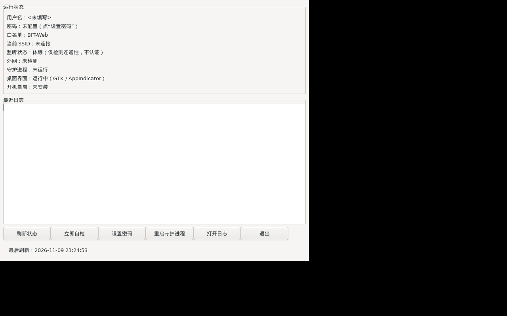

# BIT-Web Auto Login（Linux 版）

与 Windows 版共用相同的深澜（Srun）认证协议与配置文件格式；Linux 版为**纯 C / POSIX**，
无 Python 运行时依赖。支持：后台守护、SSID 状态机、只读连通性检测、断线自动认证、
systemd 用户服务、终端 TUI 与命令行。

> Linux 版提供 **CLI + TUI + GTK3 桌面面板/AppIndicator 托盘**，与 Windows 版功能对齐。
> 桌面面板在无桌面环境（如服务器）下可继续使用 CLI/TUI 和 systemd 守护进程。



## 依赖

- Linux（推荐 Ubuntu 22.04+），gcc、make、pthread；
- 可选 GUI：GTK3 + libayatana-appindicator3 运行库/开发包；
- 读取 SSID 需要 NetworkManager 的 `nmcli`（Ubuntu 桌面默认安装；
  也可用 `iwgetid` 作为回退；都没有时会休眠，只做外网只读检测）；
- 可选：`ping` 命令（HTTP 探测失败时兜底；没有也可工作）；
- systemd 用户服务（可选，用于开机自启）。

## 构建

```bash
cd linux
make                     # CLI/守护进程
make gui                 # 可选：GTK3 面板（需 libgtk-3-dev + libayatana-appindicator3-dev）
./bitweb crypto-test     # 协议签名向量自检（应与 Windows 版一致）
```

## 安装（用户级，无需 root）

```bash
cd linux
./install.sh
# 安装到 ~/.local/bin/bitweb，配置在 ~/.config/bitweb-autologin/config.json，
# 并注册 systemd 用户服务 bitweb.service

~/.local/bin/bitweb set-password
~/.local/bin/bitweb status
~/.local/bin/bitweb tui
~/.local/bin/bitweb-gui  # GTK 桌面面板（安装脚本检测到开发包时会自动构建）
```

若 `~/.local/bin` 不在 PATH，可用绝对路径或加入 PATH。
`systemctl --user status bitweb` 可查看服务状态；日志默认在
`~/.config/bitweb-autologin/logs/bitweb_monitor.log`。

卸载：`./uninstall.sh`（保留配置）；`./uninstall.sh --purge` 连配置日志一起删除。

## 命令

| 命令 | 说明 |
|---|---|
| `bitweb status` | 状态 + 外网检测 |
| `bitweb tui` | 终端控制面板（刷新、自检、设置密码、日志、重启服务） |
| `bitweb self-test` | 安装自检（含门户 discover/challenge） |
| `bitweb set-password` | 设置/更新密码（交互式，不回显） |
| `bitweb crypto-test` | 协议签名离线向量测试 |
| `bitweb login-test` | 发起一次登录请求测试 |
| `bitweb reconnect` | 通知守护进程立即检查/重连（SIGUSR1） |
| `bitweb daemon` | 前台运行守护进程（systemd 使用） |
| `bitweb-gui` | GTK3 桌面控制面板；`--silent` 仅托盘启动（登录自启） |

`--config PATH` 指定配置文件；`--simulate-ssid SSID` 或环境变量
`BITWEB_SIMULATE_SSID` 可模拟 SSID（无 Wi-Fi 的开发机/CI 测试用）。

## 运行逻辑

与 Windows 版一致：

- 每 15 秒读取 SSID；SSID 精确等于 `BIT-Web` 才进入工作状态；
- 工作状态：立即检查外网，之后每 5 分钟检查；断网则自动认证；
- 非白名单网络/有线/无 Wi-Fi：休眠，**每 5 分钟仅做只读连通性检测**，
  不访问 `10.0.0.55`、不提交认证；
- 手动 `reconnect` 或 TUI 刷新时若检测到断网，立即通知守护进程重连；
- 门户提示“IP 已在线”但外网不通时：自动注销残留会话后重登一次；
- 密码/账号错误冷却 30 分钟，未配置密码冷却 10 分钟；
- 支持配置热加载。

## 配置

路径：`~/.config/bitweb-autologin/config.json`（或 `$XDG_CONFIG_HOME`）。
字段与 Windows 版相同，见 [`config.example.json`](config.example.json)。
Linux 版不使用 Windows DPAPI：密码以 `"password"` 字段保存，并通过 `chmod 0600`
限制配置文件权限；也可用环境变量 `BITWEB_PASSWORD` 临时提供密码（优先级最高）。
**Linux 与 Windows 的 config 不能直接共用密码字段**（Windows 版是 `password_dpapi`），
在 Linux 上重新运行一次 `set-password` 即可。

## 安全与隐私

- 只在 SSID 精确等于 `BIT-Web` 时访问门户、提交认证；其他网络只做只读外网探测；
- 密码以 0600 权限保存；日志只记录脱敏学号与状态，不记录密码；
- 门户仍是 HTTP 明文，无法防御伪造同名热点 + 假门户（与 Windows 版相同）。

## 开发与测试

```bash
make
make test                       # crypto 向量
bash tests/run_tests.sh         # 本地假门户：登录链路 + 守护进程 + 休眠只读检测
bash tests/gui_xvfb_test.sh     # GTK 面板在 Xvfb 中启动并截图（CI 使用）
```

测试不依赖真实校园网：使用本地 fake portal（Python3）与 `BITWEB_SIMULATE_SSID`。
`tests/` 仅在开发时使用，生产二进制不依赖 Python。

已在 **VMware Workstation 17.5.2 + Ubuntu 22.04 cloud image** 中实际构建、运行并截图验证（Xvfb 1280×800）；详见 [docs/VMWARE_TEST.md](docs/VMWARE_TEST.md)。

## 已知限制

- 托盘图标依赖桌面环境的 AppIndicator/StatusNotifier 支持（Ubuntu 22.04 GNOME 默认可用；无桌面/Xvfb 下只显示窗口，不显示托盘）；
- GUI 需要 GTK3/AppIndicator 开发包才能本地构建；安装脚本检测不到时只安装 CLI/TUI；
- SSID 依赖 nmcli/iwgetid；无 NetworkManager 的服务器环境会退化为“仅检测、不自动认证”；
- 仅支持 HTTP 门户（BIT-Web 当前即 HTTP）。